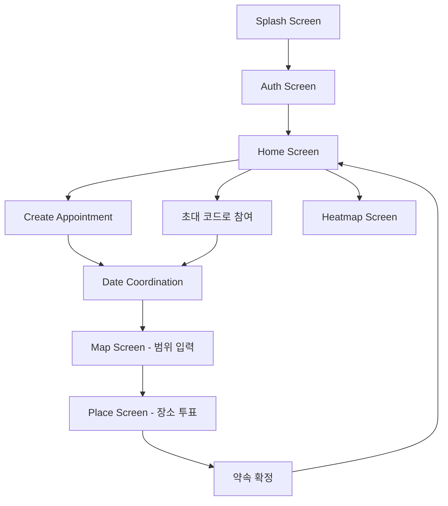

# Mobv Frontend

> 모두가 괜찮은 곳에서 만나요  
> Where everyone meets.

Mobv의 프론트엔드는 여러 멤버가 약속 장소를 정할 때, 각자가 지도 위에서 만날 수 있는 이동 범위를 원으로 설정하고 교집합 구역 기반의 추천 장소를 시각적으로 조율할 수 있는 **Flutter 기반 크로스 플랫폼(Web & Mobile) 클라이언트**입니다.

---

## 📱 Frontend Overview

- **프레임워크**: Flutter (Dart 3.11+)
- **지원 플랫폼**: Web (Chrome 우선 최적화), Mobile (Android / iOS)
- **핵심 경험**:
  - 직관적인 인터랙티브 지도 범위(원) 드로잉 & 실시간 다자간 동기화
  - Glassmorphism 기반의 모던하고 일관된 디자인 시스템
  - Web/Mobile 공통 카카오맵 JavaScript SDK 브리지 아키텍처
  - 날짜 조율 타임테이블 매트릭스, 추천 장소 카드 캐러셀 및 투표 시스템
  - 확정된 방문 기록을 시각화하는 인터랙티브 히트맵

---

## 🛠 Tech Stack & Libraries

| 분류 | 기술 / 라이브러리 | 설명 |
|------|------------------|------|
| **Core** | `Flutter`, `Dart` | 크로스플랫폼 UI 프레임워크 |
| **BaaS / Client** | `firebase_core`, `firebase_auth`, `cloud_firestore` | 인증 및 실시간 데이터 스트림 구독 |
| **Map & Location** | `Kakao Map JS SDK`, `webview_flutter`, `geolocator` | 웹/모바일 양방향 지도 렌더링 및 현재 위치 감지 |
| **Web Integration** | `pointer_interceptor` | Flutter Web 환경에서 지도 IFrame 위 UI 오버레이 클릭 보장 |
| **Network & Utility** | `http`, `url_launcher`, `uuid`, `flutter_dotenv` | 백엔드 추천 API 통신 및 외부 링크 연동 |
| **UI & Assets** | `flutter_svg`, `Pacifico Font` | 벡터 그래픽 및 브랜드 커스텀 타이포그래피 |

---

## 📂 Directory Structure

```text
lib/
├── app_config.dart             # 환경 변수 및 Dart Define 설정 주입
├── app_theme.dart              # 색상 팔레트, Glassmorphism, 텍스트/버튼 테마
├── constants.dart              # 앱 전역 상수
├── firebase_options.dart       # Firebase 클라이언트 초기화 옵션
├── main.dart                   # 앱 엔트리포인트 및 글로벌 테마/라우트 설정
│
├── models/
│   └── date_coordination_model.dart  # 날짜/시간대 조율 데이터 모델
│
├── screens/                    # 핵심 화면 UI
│   ├── splash_screen.dart             # 초기 진입 스플래시 화면
│   ├── auth_screen.dart               # 이메일 로그인 / 회원가입 화면
│   ├── home_screen.dart               # 대시보드 (진행 중인 약속, 히스토리, 참여 모달)
│   ├── create_appointment_screen.dart # 새 약속 생성 (타이틀, 인원, 카테고리, 후보 일정)
│   ├── date_coordination_screen.dart  # 멤버별 참여 가능 일정 인터랙티브 매트릭스
│   ├── map_screen.dart                # 인터랙티브 카카오맵 범위 설정 & 교집합 확인
│   ├── place_screen.dart              # 추천 장소 확인, 카카오맵 상세 보기 및 실시간 투표
│   └── heatmap_screen.dart            # 지난 약속 방문 장소 분포 히트맵 & 기록
│
├── services/                   # 비즈니스 로직 & Firestore 스트림 서비스
│   ├── auth_service.dart              # Firebase Auth 기반 사용자 로그인/세션
│   ├── appointment_service.dart       # 약속 CRUD, 상태(Status) 흐름 관리
│   ├── circle_service.dart            # 지도 위 멤버별 좌표/반경 데이터 동기화
│   ├── vote_service.dart              # 추천 장소 투표 관리
│   └── history_service.dart           # 확정된 약속 방문 히스토리 및 리뷰 조회
│
└── widgets/                    # 재사용 가능한 UI 컴포넌트
    ├── kakao_map_webview.dart         # 지도 컨트롤러 및 브리지 래퍼
    ├── platform_html_view.dart        # 조건부 익스포트 인터페이스
    ├── platform_html_view_web.dart    # Web IFrameElement 기반 지도 렌더러
    ├── platform_html_view_mobile.dart # Mobile InApp WebView 기반 지도 렌더러
    ├── glassmorphic_container.dart    # 블러 & 반투명 배경 컨테이너
    ├── glass_popup_menu.dart          # 글래스 스타일 팝업 메뉴
    ├── app_dialog.dart                # 공통 다이얼로그
    ├── gradient_button.dart           # 브랜드 그라디언트 액션 버튼
    ├── mobv_brand.dart                # 로고 및 심볼 위젯
    ├── screen_header.dart             # 공통 상단 헤더
    └── no_intersection_sheet.dart     # 범위 미교집합 시 안내 바텀시트

web/
├── kakao_map_bridge.html       # 지도 드로잉 & Flutter-JS postMessage 브리지
└── heatmap_bridge.html         # 히트맵 렌더링 JS 브리지

assets/
├── brand/                      # Mobv 심볼, 워드마크, 앱 아이콘
└── fonts/                      # Pacifico 서체
```

---

## 🎨 Design System (`AppTheme`)

- **Primary Tone**: 세련된 Modern Black (`#18181B`) & Crisp White 기반의 미니멀리즘
- **Point & Member Colors**:
  - 각 사용자에게 고유한 프로필 컬러(`profileColor`)가 부여되며, 지도 원·아바타·상태 칩에 공통 반영
- **Glassmorphism & Overlay**:
  - 지도 위 UI 요소는 `GlassmorphicContainer`를 적용하여 맵 가시성을 유지하면서 부드러운 블러 효과 제공
  - Flutter Web 환경에서 IFrame 위에 뜨는 다이얼로그나 모달을 누를 수 있도록 `PointerInterceptor` 적용

---

## 🗺️ Screen Flow & Key Features



1. **로그인 / 가입 (`auth_screen.dart`)**
   - 이메일 기반 간편 인증 및 프로필 컬러 자동 생성
2. **홈 대시보드 (`home_screen.dart`)**
   - 내가 참여한 진행 중인 약속 카드 목록 (상태별 배지 표시)
   - 플로팅 버튼을 통한 새 약속 생성 및 6자리 초대 코드로 참여 다이얼로그
   - 지난 발자취를 볼 수 있는 히트맵 진입 버튼
3. **약속 생성 (`create_appointment_screen.dart`)**
   - 약속명, 카테고리(카페, 식당 등), 최대 참여 인원 설정
   - 일정 조율이 필요한 경우 후보 날짜 및 시간대 다중 지정
4. **일정 조율 (`date_coordination_screen.dart`)**
   - 멤버별 가능/불가능 시간대를 인터랙티브한 그리드 칩으로 입력
   - 참여자 전원의 겹치는 최적 시간대를 실시간 집계하여 표시
5. **지도 범위 설정 (`map_screen.dart`)**
   - 카카오맵 위에서 내 위치를 중심으로 반경 조절 원 그리기
   - Firestore 실시간 리스너를 통해 다른 멤버들이 그린 원이 실시간 렌더링
   - 교집합 구역이 생성되면 추천 버튼 활성화 (`_MapRecommendFloatingButton`)
6. **장소 투표 & 확정 (`place_screen.dart`)**
   - 교집합 구역 기반 추천 장소 리스트 카드
   - 장소별 카카오맵 상세 정보 보기 및 멤버 실시간 투표 현황 반영
   - 투표 종료 후 최종 만남 장소 확정
7. **방문 히트맵 (`heatmap_screen.dart`)**
   - 과거 확정되었던 모임 장소들의 누적 분포를 카카오맵 히트맵으로 시각화
   - 장소별 방문 일자 및 작성된 메모/후기 타임라인 열람

---

## 🌉 Cross-Platform Map Bridge Architecture

Flutter Web과 Mobile 환경에서 카카오맵 JavaScript SDK를 동일하게 구동하기 위해 **플랫폼별 브리지 패턴**을 사용합니다.

- **Flutter Web**:
  - `web/kakao_map_bridge.html`을 `IFrameElement`로 로드
  - `window.addEventListener('message')`를 통해 Flutter와 JS 간 양방향 이벤트 통신 (원 생성, 반경 변경, 중심 이동, 교집합 영역 전달 등)
  - 웹 브라우저에서 Flutter 터치 이벤트를 맵 레이어에 가로채이지 않도록 `PointerInterceptor`로 위젯 레이어 감싸기
- **Flutter Mobile**:
  - `webview_flutter`를 통해 로컬 에셋 HTML 및 JS SDK 구동
  - `JavaScriptChannel`을 통한 네이티브-웹뷰 통신

---

## ⚙️ Frontend Environment Setup

### 1. Dart Defines 설정

웹 환경 실행 시 필요한 카카오 자바스크립트 키와 백엔드 주소는 `.dart_defines/web.json`에 정의합니다.

`.dart_defines/web.example.json`을 복사하여 `.dart_defines/web.json` 파일을 생성합니다:

```json
{
  "KAKAO_JS_KEY": "YOUR_KAKAO_JAVASCRIPT_KEY",
  "BASE_URL": "http://localhost:5000"
}
```

> **주의**: `.dart_defines/web.json` 및 Firebase 비공개 설정 파일은 보안상 Git 저장소에 커밋하지 않습니다.

### 2. Kakao Developers 허용 도메인 등록

Flutter Web 실행 시 포트를 고정하여 개발합니다:
- 개발용 로컬 주소: `http://localhost:5555`
- [Kakao Developers 콘솔](https://developers.kakao.com)의 **내 애플리케이션 > 플랫폼 > Web**에 `http://localhost:5555`를 등록해야 지도가 정상 표시됩니다.

---

## 🚀 How to Run

### 의존성 패키지 설치
```bash
flutter pub get
```

### Flutter Web 실행 (포트 고정)
```bash
flutter run -d chrome --web-port 5555 --dart-define-from-file=.dart_defines/web.json
```

### Android / iOS 모바일 실행
```bash
flutter run
```

### VS Code Debugging
`.vscode/launch.json`에 정의된 프리셋을 통해 원클릭 디버깅이 가능합니다:
- `Mobv Web (Chrome, port 5555)`
- `Mobv Web Debug (Chrome, port 5555)`
- `Mobv Android`

---

## 🧪 Code Quality & Linter

코드 정적 분석:
```bash
flutter analyze
```